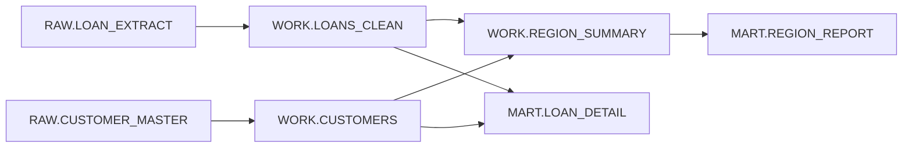

# sas-lineage-lite

A small, dependency-free Python script that reads simple SAS programs and lists **which source column feeds which target column**. It is a teaching sample: short enough to read in one sitting, and honest about what it does not handle.

```
python sas_lineage_lite.py examples/retail_loans.sas --csv edges.csv --mermaid flow.md
python sas_lineage_lite.py examples/retail_loans.sas --trace mart.region_report.cost_ratio
```

Requires Python 3.9+ and nothing else.

## What it reads

| SAS construct | What you get |
|---|---|
| `%let name = value;` and `&name` | simple text substitution |
| `data ...; set ...;` / `merge` | table-to-table column edges |
| assignments, `if/else if/else` | `DERIVED` and `CONDITIONAL` edges (condition columns included) |
| `rename=` option and `rename` statement | `RENAMED` edges that point back to the original name |
| `keep` | `DIRECT` edges |
| `proc sql; create table ... as select ...` | aliases, joins, `as` names, aggregates (`AGGREGATE`) |

Each edge records the target, source, kind, the expression text, and the file and line it came from.

## Example

`examples/retail_loans.sas` is an invented loan-reporting pipeline. Running the tool gives `examples/expected_edges.csv` and this table-level flow (`examples/flow.md`):



Tracing one field back to its raw inputs:

```
RAW.LOAN_EXTRACT.BAL -> WORK.LOANS_CLEAN.INTEREST_COST -> WORK.REGION_SUMMARY.TOTAL_INTEREST_COST -> MART.REGION_REPORT.COST_RATIO
RAW.LOAN_EXTRACT.RATE -> WORK.LOANS_CLEAN.INTEREST_COST -> WORK.REGION_SUMMARY.TOTAL_INTEREST_COST -> MART.REGION_REPORT.COST_RATIO
RAW.LOAN_EXTRACT.BAL -> WORK.LOANS_CLEAN.BALANCE -> WORK.REGION_SUMMARY.TOTAL_BALANCE -> MART.REGION_REPORT.COST_RATIO
```

## Limits (by design)

This is a sample, not a production tool. It does not handle macro definitions or calls, `%if/%do` logic, `select *` expansion, multi-step `merge` semantics, other procedures, or databases. When a data step has several inputs it writes `?` as the source table instead of guessing, and it prints a warning for constructs it skips. Treat its output as a starting point to check against the code.

## Tests

```
python -m unittest discover -s tests
```

## Licence

MIT, see `LICENSE`.
